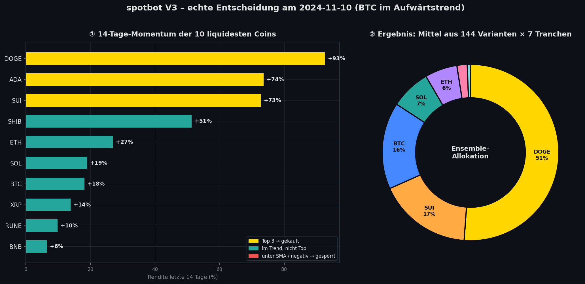
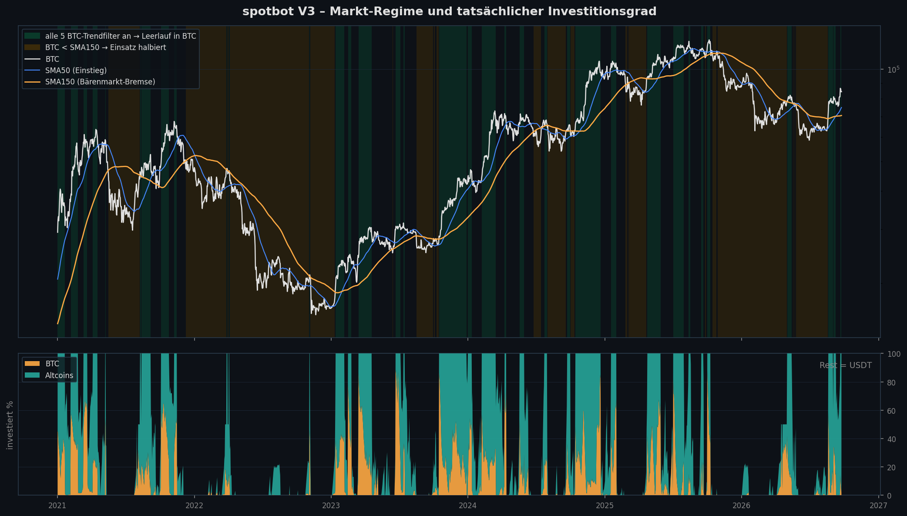
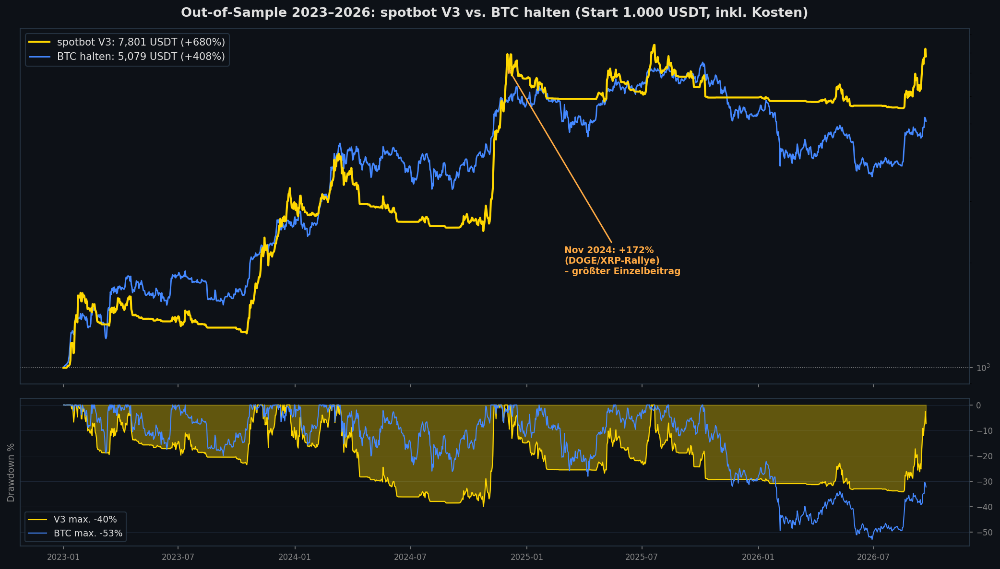
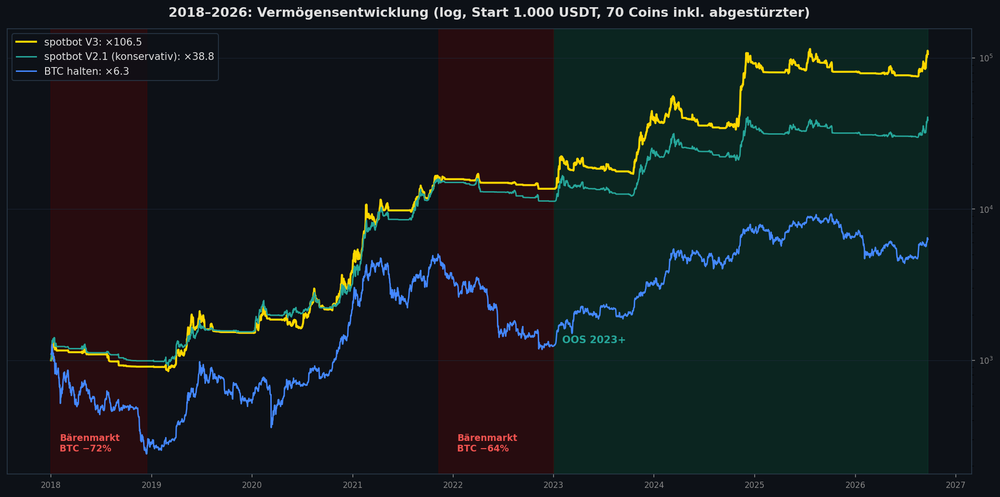
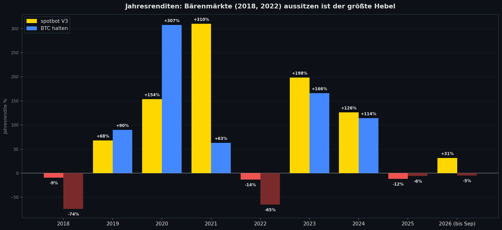
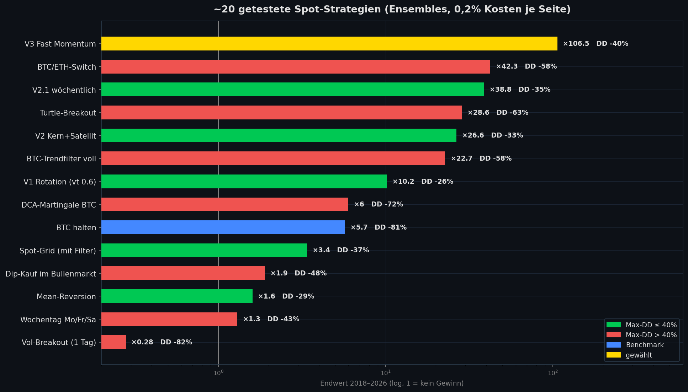

# 💎 SpotBot – Momentum-Spot-Trading für Bitget

<div align="center">


[](https://www.python.org/)
[](https://github.com/ccxt/ccxt)
[](https://www.bitget.com/)


**Long-only-Spot-Bot ohne Hebel: kauft die Coins mit dem stärksten kurzfristigen Momentum, parkt ungenutztes Kapital in BTC und sitzt Bärenmärkte in USDT aus.**

[Übersicht](#-übersicht) • [Strategie](#-strategie-v3-fast-momentum) • [Ergebnisse](#-ergebnisse) • [Installation](#-installation) • [Konfiguration](#%EF%B8%8F-konfiguration) • [Live-Betrieb](#-live-betrieb) • [Backtest](#-backtest--forschung) • [Wartung](#-wartung)

</div>

---

## 📊 Übersicht

SpotBot ist der erste reine **Spot**-Bot im Bot-Portfolio: kein Futures-Konto, kein Hebel, kein Liquidationsrisiko. Er hält jederzeit eine Mischung aus Coins und USDT und schichtet einmal täglich nach Tagesschluss (00:00 UTC) um.

### 🧭 Trading-Logik (Kurzfassung)
- **Momentum-Kern**: die 1–3 Coins mit der stärksten 7–21-Tage-Rendite unter den 5–10 liquidesten Coins, wöchentlich umgeschichtet und invers zur Volatilität gewichtet
- **Markt-Regime**: neue Käufe nur, wenn BTC über SMA50/100 liegt; fällt ein Coin unter seinen Trend, wird er sofort verkauft
- **Leerlauf → BTC**: ungenutztes Kapital geht in BTC, wenn **alle** 5 BTC-Trendfilter positiv sind, sonst bleibt es in USDT
- **Bärenmarkt-Bremse**: BTC unter SMA150 → gesamter Einsatz halbiert
- **Ensemble statt Einzelparameter**: 144 Parameter-Varianten × 7 Wochentags-Tranchen werden gemittelt, der Bot wählt keinen einzelnen "besten" Parametersatz
- **Signale = Backtest-Daten**: Signale aus Binance-Daten (wie im Backtest), Ausführung auf Bitget-Spot
- **Sicherheit**: bei API-Fehlern, veralteten Kerzen oder fehlenden BTC-Daten wird nicht gehandelt (Telegram-Meldung)

---

## 🧠 Strategie V3 "Fast Momentum"

### 🔍 Eine echte Entscheidung im Detail



Am 10.11.2024 lag BTC im Aufwärtstrend. Unter den 10 liquidesten Coins hatten DOGE, ADA und SUI das stärkste 14-Tage-Momentum. Weil 144 Varianten mit unterschiedlichen Lookbacks (7/10/14/21 Tage), Top 1/2/3 und 5/8/10 Coins gemittelt werden, entsteht daraus eine Allokation mit Schwerpunkt statt eines Alles-oder-nichts-Einsatzes.

### 🚦 Markt-Regime und Investitionsgrad



- **Grün**: alle 5 BTC-Trendfilter an (EMA10/30, EMA20/50, SMA50, SMA100, Donchian 20/10). Ungenutztes Kapital fließt in BTC.
- **Orange**: BTC unter SMA150. Der Einsatz wird halbiert, das blockiert Bärenmarkt-Rallyes.
- **Unteres Panel**: tatsächlicher Anteil BTC (orange) und Altcoins (türkis), der Rest liegt in USDT. In den Bärenmärkten 2022 und 2025/26 war der Bot überwiegend in USDT.

### ⚙️ Ablauf pro Tag
1. Cron ruft `master_runner.py` alle 15 Minuten auf. Gehandelt wird nur **einmal pro neuer UTC-Tageskerze**.
2. 400 Tage Tageskerzen der Universum-Coins von Binance laden (laufende Kerze wird verworfen).
3. `signal.fast_momentum_weights()` berechnet die Zielgewichte. Das ist **dieselbe Funktion** wie im Backtest.
4. `portfolio.plan_trades()` plant die Orders. Abweichungen < 2% werden ignoriert (No-Trade-Band gegen Gebühren).
5. Erst verkaufen, dann mit dem tatsächlich freien USDT kaufen (Market-Orders auf Bitget-Spot).
6. Die Zusammenfassung geht per Telegram raus.

---

## 📈 Ergebnisse

Backtest mit 0,1% Gebühr + 0,1% Slippage je Seite. Das Universum umfasst 70 Coins **inklusive 17 abgestürzter/delisteter** (LUNA, FTT, WAVES, MATIC …) gegen Survivorship-Bias. Signal bei Tagesschluss, Ausführung zum nächsten Open.

### 🏁 Out-of-Sample 2023–2026



| | **SpotBot V3** | BTC halten |
|---|---|---|
| Endkapital (Start 1.000 USDT) | **7.801 USDT** | 5.102 USDT |
| Gewinn | **+680%** | +410% |
| CAGR | **73,6%** | 54,7% |
| Max. Drawdown | **−40,0%** | −53,0% |
| Sharpe | **1,43** | 1,17 |

### 🌍 Gesamtzeitraum 2018–2026





### 🧪 Stresstests (OOS 2023+)

| Szenario | Endkapital | vs. BTC halten |
|---|---|---|
| Normal | 7.801 USDT | **+53%** |
| Doppelte Kosten | 6.023 USDT | +18% |
| 1 Tag verspätete Ausführung | 6.293 USDT | +23% |
| Ohne 10 Top-Gewinner-Coins | +450% (DD −51%) | +9% |
| Dreifache Kosten | 4.626 USDT | −9% |

### ⚠️ Ehrliche Einordnung
- **Der Vorsprung hängt an wenigen Rallyes.** Allein der November 2024 brachte +172% (DOGE/XRP nach der US-Wahl). **Ohne diesen Monat liegt V3 hinter BTC** (×2,86 vs. ×3,65). Nur 39% der Monate sind positiv: viele kleine Verluste, wenige große Gewinne.
- **Der Zeitraum 2023+ ist nicht mehr unberührt.** Kurzes Momentum, BTC-Füller und SMA150-Bremse wurden gewählt, nachdem 2023+ angesehen war. Die Nachbar-Einstellungen liefern ähnliche Werte, live ist aber mit weniger zu rechnen.
- **Hohe Konzentration:** meist 1–3 Schwerpunkt-Coins, der Drawdown liegt bei ~40%.
- **In reinen BTC-Jahren verliert der Bot:** 2019, 2020 und 2025 lag BTC vorn. Den großen Vorsprung holt er in Bärenmärkten und Altcoin-Rallyes.

### 🔬 ~20 getestete Strategien



Getestet wurden unter anderem Mean-Reversion, Dip-Kauf, Turtle-Breakout, Volatilitäts-Breakout, Wochentag-Effekt, BTC/ETH-Switch, **DCA-Martingale** (bei LUNA Totalverlust), **Spot-Grid**, **Anti-Martingale** und Martingale-Sizing, Funding-Rate- und Crash-Filter, 4h statt 1d sowie breitere Universen. Alle Details stehen in [RESEARCH.md](RESEARCH.md).

---

## 📋 Systemanforderungen

- **OS**: Linux (Ubuntu 20.04+) empfohlen, Windows/macOS für Backtests
- **Python**: 3.10 oder höher
- **RAM**: 2 GB reichen (ein Live-Lauf dauert ~50 s)
- **Konto**: Bitget-Spot-Konto, API-Key **nur mit Spot-Handel** (keine Auszahlungsrechte!)
- **Netzwerk**: Zugriff auf die öffentliche Binance-API (Signaldaten) und die Bitget-API

---

## 💻 Installation

### 1. Repository klonen
```bash
git clone https://github.com/Youra82/spotbot.git
cd spotbot
```

### 2. Installation ausführen
```bash
bash install.sh
```
Legt `.venv` an, installiert die Abhängigkeiten und erzeugt `secret.json` aus der Vorlage.

### 3. API-Keys eintragen (`secret.json`)
```json
{
    "spotbot": {"name": "bitget-spot", "apiKey": "...", "secret": "...", "password": "..."},
    "telegram": {"bot_token": "...", "chat_id": "..."}
}
```

### 4. Trockenlauf
```bash
.venv/bin/python3 src/spotbot/strategy/run.py --force
```
Mit `dry_run: true` (Standard) zeigt der Bot nur an, was er kaufen und verkaufen **würde**.

---

## ⚙️ Konfiguration

`settings.json` (versioniert, Strategie-Parameter):

| Parameter | Standard | Bedeutung |
|---|---|---|
| `strategy` | `fast_momentum` | V3 (alternativ `core_satellite` = V2.1) |
| `signal_exchange` | `binance` | Quelle der Signaldaten (= Backtest-Quelle) |
| `vol_target` | `1.5` | Vola-Deckel je Ensemble-Mitglied |
| `slow_sma` / `slow_floor` | `150` / `0.5` | Bärenmarkt-Bremse |
| `rebalance_band` | `0.02` | Abweichungen < 2% werden nicht gehandelt |
| `min_trade_usdt` | `5` | Mindest-Ordergröße |
| `history_days` | `400` | geladene Tageskerzen |
| `universe` | 50 Coins | nur auf Bitget-Spot aktive Coins |

`settings.local.json` (**nicht** versioniert, übersteht `update.sh`):
```json
{"spotbot": {"dry_run": false, "max_capital_usdt": null}}
```

**Konservative Alternative V2.1** (×38,8, DD −35%, OOS +244%):
```json
"strategy": "core_satellite", "vol_target": 10.0, "core_share": 0.2, "rebal_days": [7]
```

---

## 🔴 Live-Betrieb

1. Scharf schalten: `cp settings.local.json.example settings.local.json` (setzt `dry_run: false`)
2. Cronjob eintragen:
```bash
*/15 * * * * cd /pfad/spotbot && .venv/bin/python3 master_runner.py >> logs/cron.log 2>&1
```
3. **Konto**: Der Bot verwaltet **das gesamte USDT und alle Universum-Coins** im Spot-Konto. Nutze am besten ein eigenes Sub-Konto oder setze `max_capital_usdt`.
4. **Kapital**: empfohlen sind mindestens ~500 USDT. Kleinere Positionen als `min_trade_usdt` werden übersprungen.

### 📱 Telegram-Meldung (Beispiel)
```
spotbot 2026-09-24
Equity: 1000.00 USDT | Ziel investiert: 100%
Ziel: NEAR 40%, ZEC 26%, SOL 14%, UNI 7%, ETH 4%, XRP 3%, SUI 2%, BTC 2%
BUY NEAR 396.39 USDT
BUY ZEC 255.71 USDT
...
```

### 📂 Artefakte
- `artifacts/trades.csv`: alle Orders
- `artifacts/equity.csv`: tägliche Equity und Investitionsgrad
- `artifacts/state.json`: zuletzt verarbeitete Kerze und Ziel
- `logs/spotbot.log`: Lauf-Log

---

## 🧪 Backtest & Forschung

```bash
python research/fetch_data.py 1d                  # Binance-Historie ab 2017 (70 Coins)
python run_backtest.py                            # Backtest mit settings.json
python research/oos_backtest.py                   # detaillierter OOS-Report 2023+
python docs/generate_concept_illustrations.py     # README-Grafiken neu erzeugen
python -m pytest tests -q                         # Tests (nur Mocks, keine echten Orders)
```

Die Tests prüfen unter anderem:
- Das 400-Tage-Live-Fenster liefert **exakt** dieselben Zielgewichte wie der Voll-Backtest.
- Kein Lookahead: Zukünftige Kurse ändern das heutige Ziel nicht.
- API-Fehler oder eine veraltete Kerze → keine Orders.
- Im Bärenmarkt wird vollständig verkauft.

---

## 🔧 Wartung

```bash
bash update.sh    # git reset auf origin/main; secret.json, settings.local.json, artifacts/ und logs/ bleiben erhalten
```

---

## 📁 Projektstruktur

```
spotbot/
├── master_runner.py              # Cron-Einstieg (Lock, 1× pro Tageskerze)
├── run_backtest.py               # Backtest-CLI
├── settings.json                 # Strategie-Parameter
├── src/spotbot/
│   ├── strategy/signal.py        # Zielgewichte (Live = Backtest)
│   ├── strategy/portfolio.py     # Order-Planung (Live = Backtest)
│   ├── strategy/run.py           # Live-Lauf Bitget-Spot
│   ├── analysis/backtest.py      # Portfolio-Simulation
│   └── utils/                    # Exchange (Bitget/Binance), Telegram
├── research/                     # Datenabruf, Grid-Suchen, Walk-Forward, Stresstests
├── docs/                         # README-Illustrationen + Generator
└── tests/                        # pytest
```

---

<div align="center">

**⚠️ Kein Finanzrat. Krypto-Handel kann zum Totalverlust führen. Backtest-Ergebnisse garantieren keine zukünftigen Gewinne.**

</div>
